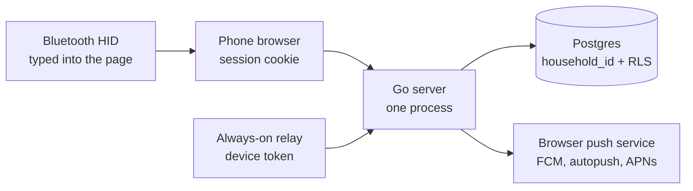

# Design: multi-tenant SaaS Stockbot

Proposal for review. This document and the mocks under `docs/design/mocks/` are the whole deliverable. It does not change the running app, and it does not open the implementation tickets listed at the end.

Issue: [#221](https://github.com/Rhionin/stockbot/issues/221). The ESP32 spike is [#222](https://github.com/Rhionin/stockbot/issues/222). As of 16 October 2026 that spike is open and has no findings branch or pull request, so this design does not depend on a board choice. It leaves a device contract the spike can implement against.

Households will include people who are not CJ. From the first hosted household onward, a member does not SSH anywhere, does not edit an `.env`, does not hold a Cloudflare token, and does not install Docker. The server they talk to is the one Stockbot runs. Updates to the web app ship by deploying that server. Updates to an always-on scanner ship as firmware the device downloads.

## Decisions

| Area | Recommendation |
| --- | --- |
| Tenant | The household is the tenant. People have their own logins and a membership (owner or member). |
| Isolation | One PostgreSQL database, `household_id` on every tenant row, row-level security as a backstop. Not a schema per household. |
| CJ's data | One-time import of the Pi's `pantry.db` into one hosted household. Push subscriptions are not imported. |
| Free scan path | The phone camera already in the web app. A Bluetooth HID scanner paired to that phone is the same path, still free. |
| Always-on scanner | Optional, later, paid. ESP32-class relay from #222, or the existing Pi forwarding scans. Both use one device-token API. |
| Device auth | Short-lived pairing code and QR shown in the app. Device stores a household-scoped token. Revocation is a row the server checks on every request. |
| Device OTA | Device polls. Two firmware slots. Rollback if the new image never proves it can reach the server. |
| Hosting | One small ARM VM in the EU running the existing Go server and Postgres. New hostname, not `stockbot.rhionin.com`. |
| Cost | About €6.50/month excl. VAT for the box and an IPv4, fixed. Marginal cost of one more idle household is cents. Estimates, sourced below. |
| Free tier | Camera, Bluetooth wedge, Web Push, invites, history. No always-on relay. |
| Paid tier | A relay with OTA, once the hardware exists. Suggested price $4/month per household. Not a cost figure. |
| Push | One VAPID key for the hosted origin. Subscriptions and the 5-minute batch are per household. |
| The Pi | Keep it as the advanced self-host path. Do not charge for it, and do not make it the way a new household starts. |

## How Stockbot works today

Stockbot is a Go server (`cmd/server`) and a React UI built into the image. On the Pi it is one container, `pantry`, from `deploy/docker-compose.yml`. Data is a single SQLite file (`DB_PATH`, default `/data/pantry.db`, driver `modernc.org/sqlite`). There is no users table. Inventory, scans, and the shopping list are stamped with the string `user_id`, and the process default is `HEADLESS_USER_ID=user-1` (`cmd/server/main.go`). The Grocy snapshot says the same thing in code: one household, `user-1` (`internal/syncsnap/snapshot.go`).

That string is not the login. The public site has one shared password. `deploy/README.md` hashes it into a Caddy basic-auth file and copies the hash to `/opt/pantry/auth/household`. `internal/server/household_auth.go` checks that hash, then sets an HttpOnly `pantry_session` cookie for 180 days. The username in the password file (the docs use `pantry`) and the data key `user-1` are unrelated. Anyone with the password can change the pantry. Port 8080 on the LAN does not ask for the password.

The documented appliance is 64-bit Raspberry Pi OS on arm64 (Pi 3B+, 4, 5, or newer). The live box this design is replacing as the default is a Pi 3B with 1 GB of RAM. The published image is `linux/arm64` only (`.github/workflows/ci.yml`).

The public name `https://stockbot.rhionin.com` reaches that Pi through a remotely managed Cloudflare tunnel (`pantry-pi`) defined in `deploy/docker-compose.tunnel.yml`. `pantry.rhionin.com` redirects while the legacy host is set. The tunnel token, the Dynu DNS client, and the `.env` all sit on hardware CJ administers.

Scans enter in three ways already:

1. A HID barcode scanner on the Pi. `SCAN_INPUT=device` reads evdev at `/dev/input/pantry-scanner` (`deploy/scan-input.md`, `internal/scanlistener`). The Symcode (ASIN B01M264K5L) pairs as a keyboard. A udev rule matches Bluetooth HID the same way it matches USB. The listener retries a missing device; the container still serves the UI with no scanner attached.
2. The phone camera. `frontend/src/components/scanner/CameraScanner.tsx` captures frames in the browser (native detector, then ZXing) and hands the barcode to the same `onScan` path as the hardware scanner. The camera stays off until someone asks for it.
3. A keyboard wedge in the page. `BarcodeInputField.tsx` focuses a hidden field and treats a burst of digits plus Enter as a barcode. A Bluetooth scanner paired to the phone behaves as that keyboard, as long as the page is open and the field is focused.

Direction comes from control barcodes (`STOCK_IN` / `STOCK_OUT` by default) or from the on-screen toggle. The scanner itself does not know stock-in from stock-out.

Web Push is one VAPID keypair in the Pi's `.env` (`VAPID_PUBLIC_KEY`, `VAPID_PRIVATE_KEY`, `VAPID_SUBJECT`). `push_subscriptions` is keyed only by endpoint. There is no household and no user on the row (`internal/app/migrations/015_push_subscriptions.sql`). `Sender.Notify` loads every subscription and delivers the same notice (`internal/push/send.go`). A stock-in batch and a stock-out batch each wait `BatchSettle` (5 minutes). When the timer fires, `stillPending` drops scans that are no longer waiting, and the notice goes out only if at least one remains (`internal/push/attention.go`). The open batch is stored in `scan_alert_schedule` with primary key `direction`, so the process can have only one stock-in wait and one stock-out wait (`017_scan_alert_schedule.sql`). Firefox for Android is the tight pipe: Mozilla's autopush bridge rejects an encrypted record that blows the FCM 4096-byte data map, so plaintext is capped at 2500 bytes and the record is sized to the payload (`internal/push/payload.go`, `send.go`).

Product rows and global barcodes are a shared catalog (Open Food Facts, cached; `PRODUCT_CACHE_TTL` defaults to 720h). A household override is a `barcodes` row with `source = user_override`. Retailer OAuth tokens and developer-app secrets live in SQLite in the clear (`provider_connections`, `provider_app_credentials`). The comment on that migration says the database file is the secret store, which is true for one household's Pi and false once strangers share a server.

Grocy is optional and one-way. The `grocy` compose profile runs a sidecar with a 64 MB limit. It pulls a snapshot with `PANTRY_SYNC_TOKEN` and writes to a Grocy the household already runs (`deploy/docker-compose.grocy.yml`).

The in-process event broadcaster is how open tabs see a scan immediately. Push exists so a closed tab still hears about it. Both assume one process and one pantry.

## Tenant model

### Options

**Row-level `household_id` in one database.** Every tenant-owned table carries the household. The request's household comes from the session or the device token, never from the client body. Postgres row-level security rejects a query that forgot the filter.

**A schema per household.** Migrations, connection pooling, and backups multiply by the number of households. A free tier of many small pantries pays that cost on every deploy. Cross-household product cache and a global barcode catalog become awkward on purpose.

**A database per household.** Stronger isolation, and a fair choice for a handful of large paying teams. It is a poor fit for a free pantry: idle databases still cost connections and backup jobs, and the Pi's SQLite file already shows that one household's data is small.

### Recommendation

Row-level `household_id` in one Postgres database, with row-level security enabled for the application role. The application still sets the household on every query. RLS is the backstop for the day a query forgets, which is the failure mode that matters once strangers share the server. [Postgres RLS](https://www.postgresql.org/docs/current/ddl-rowsecurity.html) applies policies to ordinary queries from that role. The role must not be a superuser, and it must not own the tables, or the policies do not bind.

Schema-per-tenant and database-per-tenant stay off the table unless a later household has a legal requirement this design does not have.

### People, memberships, invites

Add three tables the appliance does not have:

- `users` — email, password hash, created time.
- `households` — name, plan (`free` or `relay`), created time.
- `memberships` — user, household, role `owner` or `member`.

Signup creates the user, the household, and an owner membership. Invite creates a single-use token, emailed, valid for 7 days. Accepting it creates a member membership and sets that person's password. The owner can remove a member. Removal deletes that member's push subscriptions and sessions. It does not delete scans or stock.

Any member can scan, change the pantry, pair a scanner, and revoke a scanner. A household that invited someone trusts them with the kitchen. Only the owner can invite, remove a member, export, or delete the household.

v1 UI assumes one membership per person. The table still allows a second household later without a rewrite. There is no shared household password on the hosted origin.

The daily session stays a long cookie, on the order of the 180 days the Pi uses today. People open Stockbot with groceries in their hands. Email is for the invite and for password reset, not for every visit.

### What is shared, and what is a household's

Shared, and not stamped with a household: the global product catalog and global barcodes, and the cached "this barcode missed" rows. Those come from Open Food Facts and contain no member identity.

Stamped with `household_id`: items and the `user_id` that is really a household today, item instances, scan entries, shopping rows, groups and their members, suggestions, stock moves, consumption, supply overrides, brand preferences, deals, cart skips, provider connections, and household settings. `user_override` barcodes become household overrides.

Stamped with both household and user: push subscriptions, and audit-worthy actions where it is cheap (who paired a device, who revoked it). Stock moves do not need an actor in v1.

`provider_app_credentials` holds a retailer developer-app secret per `user_id` today. On the hosted service that secret is Stockbot's, in the server environment, not something a household pastes. Household rows keep OAuth tokens only. If a retailer will not let one developer app act for many households, cart linking stays on the self-hosted path until it will. Confirm that before building hosted cart linking. Tokens that do land in Postgres are encrypted by the application (AES-GCM, key in the environment) before self-serve signup. RLS still applies to those rows.

`app_settings` is global today. Split household settings out of it. Do not put one household's contribution opt-in on a row every household reads.

### Appliance and hosted, one schema

The Pi keeps SQLite. Hosted uses Postgres. Business logic stays in one place; a thin dialect boundary covers placeholders (`?` versus `$1`), the few datetime expressions that differ, and the migration files. RLS policies exist only in the Postgres migrations.

Do not run Postgres on the 1 GB Pi. Do not fork the product into two codebases.

The first schema change adds `households` and `household_id` to the SQLite migrations, backfills one local household, and points today's `user-1` rows at it. The appliance keeps the shared password and `HEADLESS_USER_ID`. Hosted mode refuses to boot without real accounts.

SQLite on the VM is acceptable only for an invite-only dry run that CJ controls. It has no RLS. Self-serve signup waits on Postgres.

### Tests

The project's API tests are the right check. Two households, through HTTP: neither can read or write the other's scans, inventory, shopping list, groups, history, or push subscription. A device token for one household posting a barcode must land in that household only. Direct database checks are a last resort; the leak that matters is the one an HTTP client can see.

## Scan input

Three ways to scan. The first two are the free product. The third is optional hardware.

### 1. Phone camera, the free default

Already built. The browser decodes the barcode and the signed-in session posts it. No device token, no pairing, no pantry gadget that has to stay powered. This is what a new household uses on the day they sign up.

Limits to say in the product, not to paper over: the camera works when the page is open and the person has granted it. iOS Safari can do this. An always-on pantry scanner is a different product, below.

### 2. Bluetooth scanner paired to the phone or tablet

The Symcode is a HID keyboard. Paired to a phone, it types into `BarcodeInputField` the same way it types into evdev on the Pi. The phone must be awake, the Stockbot page open, and that field focused. The component already focuses itself without scrolling, and it ignores password-manager autofill.

This stays free. It does not create a device row. The session is the credential. Android Chrome is the combination to support. iOS keyboard-wedge behavior is inconsistent enough that the free-tier promise is the camera, with the wedge documented as "works when the phone treats the scanner as a keyboard."

A household can keep the Symcode they already own. They pair it to a phone instead of to the Pi.

### 3. Always-on relay

A small device in the pantry accepts the Symcode (or its USB dongle) and POSTs barcodes when the phones are in a drawer. #222 is the hardware spike: which radio the Symcode actually speaks, whether a classic ESP32 (BR/EDR + BLE) or a BLE-only chip (S3, C3, C6) can host it, and whether USB host on an S2/S3 plus the dongle is the reliable path. This design does not pick a chip. It does pick the shape:

- The relay is optional. The free tier is useful with zero relays.
- It speaks the device API below. It does not join the household's Wi-Fi and also get an SSH account.
- Until #222 names a board, do not buy parts and do not write firmware in the SaaS tickets.
- The same API accepts a forwarder mode on the existing Pi, so CJ's Symcode can keep scanning after the data moves, without waiting on the ESP32.

Control barcodes pass through unchanged. The relay does not decide stock-in versus stock-out. The server already does, from `STOCK_IN` / `STOCK_OUT` and the household's current mode.

## Device auth

Phones do not use this. A logged-in member's camera or wedge is enough. Device auth is for a box that scans while nobody is looking at a session.

### Pairing

A member opens Scanners and asks for a code. The server stores a single-use grant: random code, hashed at rest, 10-minute expiry, bound to that household.

The app shows the code in clear text and as a QR. Both are the same grant. The QR encodes `https://app.stockbot.rhionin.com/pair?code=K7MP-Q4R2` (the code in the mock is an example). A headless ESP32 cannot scan the phone's screen, so the person types the code into the device's setup page. The QR is for a setup page that can open the camera, and for a second phone.

Wi-Fi onboarding is the device's captive portal, which #222 investigates. Stockbot does not learn the household's Wi-Fi password. The device, once on the network, calls `POST /api/device/pair` with the code, a name the person chose, and a board id. The response is a token shown once: 32 random bytes. The server stores only a hash. The device stores the token in its own flash.

### Requests after pairing

`Authorization: Bearer` on:

- `POST /api/device/scans` — `{ "id", "barcode", "scanned_at" }`. `id` is the device's id for that scan, stable across retries.
- `POST /api/device/heartbeat` — firmware version, board id, buffer depth. The response may include an OTA offer.

The token resolves to a household. A revoked or unknown token is 401. The server never accepts a household id from the body.

### Revocation

The member revokes from the scanner list. The row gets `revoked_at`. The next request fails, including a retry of a buffered scan. The device treats 401 as "unpaired" and stops retrying that token (an LED or the setup portal is #222's problem; the server's job is the 401). Scans already committed stay in the pantry. Pairing again mints a new token. There is no long-lived JWT to chase down; the row is the revocation list.

### Offline buffer

The device keeps a ring of scans in flash while Wi-Fi is down. Cap it (500 is enough for a shopping trip and a long outage; older than that, drop the oldest and count the drop in the next heartbeat). Each entry is the same body the POST would send, including `id`.

On reconnect, send in order, with backoff. The server's unique key is `(device_id, id)`. A retry of a scan already stored returns success and does not create a second queue card.

`scanned_at` is the device clock. If it is more than 24 hours off the server, store the server's receive time and keep the device time beside it. A scanner must not silently rewrite last month's history because its clock was unset.

The phone paths do not get this buffer in v1. If the phone is offline, the scan fails visibly and the person retries. A service-worker queue is a later improvement, not a requirement for the free tier.

## Device OTA

Firmware updates come from the server. Nobody ships a binary to a household by hand.

The device polls heartbeat. It does not listen for a push. When the offered version is newer for that board id, it downloads the image over HTTPS, checks the size and SHA-256 from the manifest, writes it to the inactive OTA slot, and reboots.

Use the ESP-IDF layout: two app slots plus otadata, and `CONFIG_BOOTLOADER_APP_ROLLBACK_ENABLE`. After reboot the new image is pending. It must confirm itself with `esp_ota_mark_app_valid_cancel_rollback` only after it has joined Wi-Fi and completed a heartbeat. If it reboots first, or it marks itself invalid, the bootloader returns to the previous image. Espressif's guide describes that state machine: one attempt to boot, then rollback if the app never confirms. [OTA and rollback](https://docs.espressif.com/projects/esp-idf/en/stable/esp32/api-reference/system/ota.html).

Confirm after a short soak (on the order of ten minutes of successful heartbeats), not on the first instruction of `main`. An image that crashes before the confirm rolls back. An image that confirms and breaks an hour later does not; the fix is a newer image. Pulling a bad manifest stops devices that have not updated yet. It does not rewind a device that already confirmed.

Sign images. HTTPS plus a hash stops a casual swap. Secure boot is a #222 decision, because it depends on flash size and on whether the board can store a key. The server refuses to offer an image whose board id does not match the device.

Roll out to one device first (CJ's), then the rest. The manifest is per board and per channel. Households do not pick a firmware file.

The Pi appliance does not use this. It keeps today's image pull: GitHub Actions posts to `/api/deploy-hook`, the host unit pulls `ghcr.io/rhionin/pantry`. That hook is an appliance feature. The hosted origin does not expose it to households.

## Hosting and cost

### Where it runs

One always-on Linux VM in the EU, the existing Go binary, Caddy for HTTPS, PostgreSQL on the same machine. One process. The broadcaster and the batch scheduler already assume that. A second app instance would race the "claim this batch" delete in `attention.go`. Split the process only when the box is actually busy.

Hostname: `https://app.stockbot.rhionin.com`. Leave `stockbot.rhionin.com` on the Pi. Cookies, the service worker, and VAPID subscriptions are scoped to the origin. Pointing the SaaS at the Pi's name would log people into the wrong server and would strand or collide push subscriptions.

Do not rewrite the server onto Cloudflare Workers to chase a cheap database. The application is Go, SQLite-shaped SQL, and a large API test suite. Workers plus D1 would be a second product. The Workers Paid plan is $5/month and D1's included reads are large ([Workers pricing](https://developers.cloudflare.com/workers/platform/pricing/), [D1 pricing](https://developers.cloudflare.com/d1/platform/pricing/)), and that price is not worth a rewrite before there are households.

Do not start on Fly Managed Postgres. The Basic plan is $38/month before storage ([Fly resource pricing](https://docs.fly.io/about/pricing)). That is several times the VM that can run both the app and Postgres at this size.

Neon’s free plan is $0 and includes 100 CU-hours and 1 GB per project, and compute suspends after 5 minutes of idle ([Neon plans](https://neon.com/docs/introduction/plans)). Suspension makes the first scan after a quiet afternoon wait on a cold database. Skip it for production. A warm Postgres on the VM is the point.

### The box

Prefer Hetzner’s ARM cost-optimized plan **CAX11**: 2 Ampere vCPU, 4 GB RAM, 40 GB NVMe, 20 TB included traffic at EU locations ([cost-optimized plans](https://www.hetzner.com/cloud/cost-optimized/)). The published Stockbot image is already `linux/arm64`. After the 15 June 2026 adjustment, CAX11 in Germany or Finland is **€5.99/month excl. IPv4 and VAT** ($6.99 in Hetzner’s dollar column) ([price adjustment](https://docs.hetzner.com/general/infrastructure-and-availability/price-adjustment/)).

A primary IPv4 is extra: **€0.50/month excl. VAT** ($0.60). Primary IPv6 is free ([primary IPs](https://docs.hetzner.com/cloud/servers/primary-ips/overview/)).

CX23 is the x86 plan at €5.49/month excl. IPv4 ($6.49) on that same price table, with 2 vCPU, 4 GB, and 40 GB. It needs an `linux/amd64` image this repo does not publish yet. On 16 October 2026 the cost-optimized page showed CX23 as not orderable. Treat availability as something to recheck in the console. CX33 is the next x86 step on the price table at €8.49/month excl. IPv4 ($9.99).

4 GB is the comparison that matters against the Pi’s 1 GB: the app, Postgres, and Caddy fit, and the workload is short writes plus a cached product lookup.

### Estimate, fixed

These are list prices checked on 16 October 2026, excluding VAT. A private customer in a VAT country pays VAT on top. They are estimates in the sense that Hetzner can change a plan or be out of stock; the figures below are the published ones, not a measured invoice.

| Line | Estimate | Source |
| --- | --- | --- |
| CAX11, DE/FI | €5.99/month excl. IPv4 | [Hetzner price adjustment, 15 June 2026](https://docs.hetzner.com/general/infrastructure-and-availability/price-adjustment/) |
| Primary IPv4 | €0.50/month | [Primary IPs](https://docs.hetzner.com/cloud/servers/primary-ips/overview/) |
| Transactional email | $0 while under 3,000/month and 100/day | [Resend pricing](https://resend.com/pricing) |
| Web Push | $0 | Browser services. Apple’s Web Push does not require the Apple Developer Program ([Apple](https://developer.apple.com/documentation/usernotifications/sending-web-push-notifications-in-web-apps-and-browsers)) |
| Open Food Facts | $0 | Already the lookup path; cache default 720h |
| Backups | well under €1/month at this size | Estimate. A household is megabytes, not a media library. `pg_dump` to object storage. |

**Fixed platform, about €6.50/month excl. VAT** (CAX11 plus IPv4), on the order of **$7.60** using Hetzner’s dollar column ($6.99 + $0.60). Traffic at pantry volume does not approach 20 TB.

### Estimate, per household

Almost all of the cost is the box, whether one household uses it or fifty.

- One household: the whole ~€6.50. That is what the free tier costs CJ until someone pays for a relay or the project is shut off.
- Fifty idle households on the same box: about €0.13 each. This is arithmetic on the list price, not a load test.
- Two hundred is still a reasonable planning guess for one 4 GB box, because a scan is a small write and product lookups are cached. Move when RAM or CPU says so, not at a household count invented here.

The paid relay does not change the hosting math in a meaningful way. A heartbeat and a barcode POST are smaller than a person loading the UI. The $4 price below is a product price, to pay for the fixed box and for supporting hardware, not a pass-through of cloud cost.

### Free and paid

**Free, no card.** One household, up to 8 members, phone camera, Bluetooth wedge into the signed-in phone, Web Push, product lookup, shopping list, history kept the way it is today. Zero always-on relays. History is not the thing to paywall. People will not trust a pantry that forgets.

**Paid relay, later.** Suggested **$4 per household per month** (or about $36/year), including one relay and its OTA updates. A second relay can be an add-on once more than one household asks. Do not sell this until #222 has a board and a device can actually stay paired. Until that day, the free column is the whole product.

Grocy sync stays on the self-hosted path. The sidecar needs a Grocy URL and API key and a puller next to that Grocy. Hosted v1 does not run a sidecar per household.

## Push and notifications

Keep the behavior households already have. Change who can receive it.

One VAPID keypair for `app.stockbot.rhionin.com`, in the server environment, not in the image and not per household. Subscriptions are bound to that origin. The Pi keeps its own keys and its own origin. Importing `push_subscriptions` into the hosted database would not work: the endpoint is for the old origin, and the row has no user.

Add `household_id` and `user_id` to `push_subscriptions`. `Notify` sends only to subscriptions for the household that owned the scan. Removing a member deletes their rows. A 404 or 410 from the push service still deletes the row, as today.

`scan_alert_schedule`’s primary key becomes `(household_id, direction)`. The in-memory batches in `attention` key the same way. Today’s single stock-in row would either mix two households’ scans into one notice or drop one of them.

The quiet period stays 5 minutes. `stillPending` stays. One notice per direction per household, fanned out to every subscribed member of that household, which is the same “all of this pantry’s browsers” rule as the Pi, scoped correctly.

The payload caps stay: 2500 bytes of plaintext, record sized to the payload, so Firefox for Android does not get a 413 from autopush. Titles stay short. The URL stays a path on the hosted origin. Do not put one household’s product names into another household’s push. The tag on the notice should include the household id so two households’ stock-in alerts do not replace each other in the same browser, in the case where one person is ever in two households.

iOS is a known gap, not a bug to hide. Web Push on iPhone and iPad works for a Home Screen web app, not for a tab, from iOS 16.4 ([WebKit](https://webkit.org/blog/13878/web-push-for-web-apps-on-ios-and-ipados/)). The current product’s promise is Chrome and Firefox, desktop and Android. v1 of hosted keeps that promise. iPhone users can still scan with the camera in the browser. Alerts on iPhone wait until someone adds the site to the Home Screen and the manifest’s display mode is standalone, which is a later polish ticket, not a launch blocker.

## The self-hosted Pi

**Keep it.** Do not deprecate it, and do not turn it into a paid plan.

The deploy docs, the tunnel, the udev rule, the image publish, and the deploy hook are a working appliance. CJ’s pantry runs on it. Charging for self-host would mean supporting strangers’ routers, SSH, `.env` files, and Cloudflare accounts, which is the setup this SaaS exists to avoid. Deprecating it throws away the appliance and forces a migration on day one.

What “keep” means in practice:

- New households sign up on `app.stockbot.rhionin.com`. The README’s Pi path stays, labeled advanced self-host.
- Appliance mode remains one SQLite file, one local household, the shared password, the tunnel if the operator wants it.
- Schema migrations that add `household_id` backfill that single local household, so `setup.sh` and the image pull keep working.
- Hosted-only features (invites, device OTA, a public signup) are not requirements for the Pi.
- The image keeps publishing for arm64. The deploy hook keeps updating CJ’s Pi.
- Grocy sync stays documented here, not in the hosted app.

A Pi forwarder is a migration aid, not a fourth product. With a device token and a URL, the existing evdev listener POSTs barcodes to the hosted ingest instead of writing the local queue. CJ can move the data, keep the Symcode on the Pi, and turn the local site off once the hosted pantry looks right. Other households do not need this.

## Strangers, from the first hosted household

Even while the only member is CJ, the hosted server follows these rules, so the second household is not a redesign:

- No SSH, no customer `.env`, no customer Cloudflare account, no customer Docker.
- A member sees one household. Queries take the household from the session or the device token.
- Retailer tokens are encrypted. The retailer developer secret, if hosted cart linking happens, is Stockbot’s env var.
- Auth failures stay rate-limited. The Pi’s gate is 5 failures in 15 minutes (`household_auth.go`). Hosted applies a limit per account and per address, and a separate limit on invites and on device scan posts, so one token cannot flood Open Food Facts.
- Public unauthenticated routes shrink. `/brand/logo.png`, `/terms`, and `/privacy` stay public, because retailer apps and people need them. `/api/telemetry` and `/api/build` become operator-only on the hosted origin. `/api/deploy-hook` is not on that origin. Port 8080 without a login does not exist there.
- The owner can export the household (the Grocy snapshot shape is close) and can delete it. Deleting removes memberships, devices, push subscriptions, and tenant rows. It does not delete global catalog rows other households use.
- Backups of the VM are CJ’s to restore. They are not a feature households operate.

## Moving CJ’s pantry

1. Copy `pantry.db` with SQLite’s backup API so the copy is consistent. Leave the Pi running.
2. Create the hosted household and CJ’s owner login.
3. Import rows whose `user_id` is `user-1` (and child rows that point at them: instances, moves, groups) onto that `household_id`. Insert global products and barcodes if the hosted catalog does not have them yet. Household barcode overrides stay overrides.
4. Do not import `push_subscriptions`, the VAPID keys, the shared password, `PANTRY_SYNC_TOKEN`, or the deploy-hook secret. CJ turns scan alerts back on in the hosted origin. The Pi’s alerts keep working until the Pi stops sending them.
5. Check the hosted pantry through the HTTP API: item counts, pending scans, shopping lines. Compare to the Pi. Do not declare the import done from a row count alone if the API disagrees.
6. Point the Symcode at a phone, or turn on the Pi forwarder with a device token. Keep the Pi’s copy until a week of hosted use looks right.
7. Leave `stockbot.rhionin.com` on the tunnel until CJ decides the Pi no longer needs a public name. The hosted app never takes that name.

## Mocks

Static screens for the four new flows. They use the locked mark (`frontend/public/mark.svg`: food can, metal rims, four corner sights) and the locked colors: teal `#0D9488` for primary and Full, amber `#F59E0B` for Low, `#EF4444` for Out.

| Flow | Screen |
| --- | --- |
| Household signup | [signup.html](mocks/signup.html) · [signup.png](mocks/signup.png) |
| Invite | [invite.html](mocks/invite.html) · [invite.png](mocks/invite.png) |
| Phone camera | [camera-scan.html](mocks/camera-scan.html) · [camera-scan.png](mocks/camera-scan.png) |
| Pairing code and QR | [pair-device.html](mocks/pair-device.html) · [pair-device.png](mocks/pair-device.png) |
| Revocation | [devices.html](mocks/devices.html) · [devices.png](mocks/devices.png) |

The pairing QR encodes `https://app.stockbot.rhionin.com/pair?code=K7MP-Q4R2`. The code is illustrative.

A phone camera and a Bluetooth wedge never show up on the scanner list. The devices mock says so, because that split is the thing a reviewer has to see.

## Implementation tickets

For approval. Not opened as GitHub issues. Order is the order to build. A ticket can start when everything it depends on is done.

1. **Add a household key to the appliance schema**
   Scope: `households` table, `household_id` on tenant tables, backfill one local household from `user-1`. Queries take a household. The Pi still boots, still uses the shared password, and still scans.
   Depends on: none.

2. **Accounts and memberships in hosted mode**
   Scope: users, owner/member memberships, email and password, long session cookie, password reset by email. Hosted mode will not start on the shared household password. Appliance mode is unchanged.
   Depends on: 1.

3. **Invites**
   Scope: single-use invite, 7-day expiry, email via the transactional provider, accept joins the household. Owner can remove a member, which deletes that member’s sessions and push subscriptions.
   Depends on: 2.

4. **Cross-household API tests**
   Scope: two households, HTTP only, covering scans, inventory, shopping, groups, history, and push. A device token’s barcode lands in the right household. This is the test that has to stay green for every later ticket.
   Depends on: 1. Full push and device cases land as those tickets do.

5. **Postgres and row-level security for the hosted server**
   Scope: Postgres migrations, the dialect boundary, RLS policies using a session household id, application role that is not table owner. Encrypt retailer tokens. Appliance stays on SQLite.
   Depends on: 1 and 4.

6. **Stand up the hosted origin**
   Scope: `app.stockbot.rhionin.com`, the ARM VM, Caddy, backups, one VAPID keypair, secrets in the environment. No deploy hook. Telemetry and `/api/build` are operator-only.
   Depends on: 2 and 5.

7. **Import the Pi pantry**
   Scope: one-off importer from a SQLite backup, map `user-1` to CJ’s household, skip push subscriptions and secrets, verify through the HTTP API.
   Depends on: 5 and 6.

8. **Scope Web Push by household**
   Scope: subscription rows gain household and user. Schedule primary key becomes `(household_id, direction)`. Fan-out and the in-memory batches follow. Keep the 5-minute settle, `stillPending`, and the autopush size caps.
   Depends on: 1 and 2.

9. **Make the phone the default scanner on the hosted app**
   Scope: camera and Bluetooth wedge on a signed-in session, empty states for a household with no Pi and no relay. No device token on these paths.
   Depends on: 2.

10. **Pair and revoke a device**
    Scope: 10-minute code and QR, hashed device token, household taken from the grant, revocation row, scanner list. Phones do not appear on the list.
    Depends on: 2.

11. **Device scan ingest and the offline contract**
    Scope: `POST /api/device/scans` with idempotency, control barcodes handled by the existing server logic, clock-skew rule, heartbeat that reports buffer depth. Document the 500-scan ring the firmware must keep. No firmware in this ticket.
    Depends on: 10.

12. **Export and delete a household**
    Scope: owner can download the household’s data and can delete the household’s tenant rows, memberships, devices, and push subscriptions. Global catalog rows stay.
    Depends on: 2 and 5.

13. **Free-tier limits**
    Scope: enforce 8 members and zero relays on the free plan. A relay requires the paid flag. Camera, wedge, push, and history stay free.
    Depends on: 3 and 10.

14. **Open self-serve signup**
    Scope: anyone can create a household, under the rate limits. This is the ticket that makes strangers real.
    Depends on: 3, 4, 5, 6, 8, 9, and 12.

15. **Pi scan forwarder**
    Scope: appliance mode that POSTs evdev barcodes to the hosted ingest with a device token, so the Symcode on the Pi survives the import. Off by default.
    Depends on: 7 and 11.

16. **OTA manifest**
    Scope: firmware channel per board, version, SHA-256, staged rollout, heartbeat offers the image. Rollback rules are the ESP-IDF ones in this document. No device firmware until #222 names a board.
    Depends on: 11 and the findings from #222.

Tickets 15 and 16 are not on the path to self-serve signup. Ticket 15 is how CJ’s scanner moves. Ticket 16 waits on the spike.

## Sources

Prices and platform facts were checked on 16 October 2026. Plan prices exclude VAT. Per-household figures that divide the VM price are estimates, not measurements.

- Hetzner price adjustment, 15 June 2026, including CAX11 at €5.99 / $6.99 per month excl. IPv4 in Germany and Finland: <https://docs.hetzner.com/general/infrastructure-and-availability/price-adjustment/>
- Hetzner CAX11 shape (2 Ampere vCPU, 4 GB RAM, 40 GB, 20 TB included at EU locations): <https://www.hetzner.com/cloud/cost-optimized/>
- Hetzner primary IPv4 at €0.50 / $0.60 per month excl. VAT, primary IPv6 free: <https://docs.hetzner.com/cloud/servers/primary-ips/overview/>
- Fly.io Managed Postgres Basic at $38/month: <https://docs.fly.io/about/pricing>
- Neon free plan (100 CU-hours, 1 GB, suspend after 5 idle minutes): <https://neon.com/docs/introduction/plans>
- Cloudflare Workers and the included D1 allotment: <https://developers.cloudflare.com/workers/platform/pricing/> and <https://developers.cloudflare.com/d1/platform/pricing/>
- Resend free tier, 3,000 emails/month and 100/day: <https://resend.com/pricing>
- ESP-IDF OTA rollback: <https://docs.espressif.com/projects/esp-idf/en/stable/esp32/api-reference/system/ota.html>
- Postgres row-level security: <https://www.postgresql.org/docs/current/ddl-rowsecurity.html>
- Web Push on iOS Home Screen web apps: <https://webkit.org/blog/13878/web-push-for-web-apps-on-ios-and-ipados/>
- Apple Web Push without an Apple Developer Program membership: <https://developer.apple.com/documentation/usernotifications/sending-web-push-notifications-in-web-apps-and-browsers>
